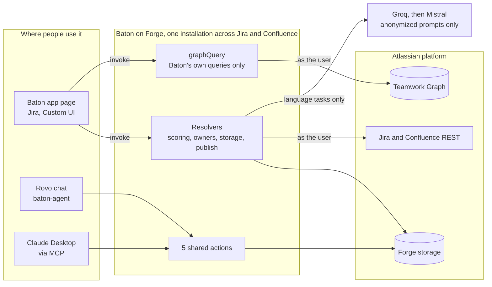

# Baton

**Baton turns a departing teammate's scattered work into a ranked handover in minutes.**

When someone leaves, goes on leave or changes teams, their context leaves with them: open Jira work goes stale, pull requests sit unreviewed, and pages only they maintained rot. Managers rebuild this by hand, from memory, usually after the person is gone.

Baton does it before their last day. It finds every open item the person owns across Jira, Bitbucket and Confluence, scores each one for **knowledge risk** ("only this person has touched it"), suggests who should take it over, and asks the person **targeted questions** to capture what's only in their head. Then it publishes the handover to Confluence and reassigns the work.

Built on Atlassian Forge for [Codegeist 2026](https://codegeist2026.devpost.com/): **Apps for Software Teams**, aiming at the **Best Agents**, **Best app with MCP** and **Teamwork Graph** bonus prizes.

## What it does

1. **Start a handover.** Pick the person, the reason (leaving, leave, team change) and their last day.
2. **Build the inventory.** Baton reads Teamwork Graph for the person's open Jira work, the Bitbucket PRs they wrote or review, the Confluence pages they own, their teams, goals and projects.
3. **Score knowledge risk.** Each item gets a 0–100 score with plain-language reasons: *Only Meera has worked on this*, *Work is mid-flight*, *No other reviewer*, *Stale*, *Due soon after they leave*, *Widely referenced page*.
4. **Suggest owners.** The top three candidates per item, ranked from co-contribution, team membership and workload, each with a reason.
5. **Capture what's unwritten.** An LLM writes 5–10 concrete questions from the riskiest items; the departing person answers them in Baton.
6. **Publish and reassign.** Baton writes the handover narrative, publishes it as a Confluence page with @mentions of the new owners, and bulk-reassigns the chosen Jira issues after a confirmation step.
7. **Ask it anywhere.** The **Baton** Rovo agent and the **Baton handovers** MCP server answer questions such as *"Who owns PAY-1 now?"* and can start a handover, from Rovo chat or from an external AI client like Claude Desktop.

## How it works



- **Everything runs as the signed-in user,** so people only ever see work they already have access to. Graph reads go through a backend resolver that runs only Baton's own named queries.
- **Scores are deterministic code, not the LLM.** Risk and owner ranking are pure, unit-tested functions, so the same inventory always gets the same scores.
- **The LLM only writes language:** the questions, one-line item summaries and the narrative. It gets scored items as JSON and its output is checked against a schema; any item it invents is stripped.
- **Only anonymized prompts leave Atlassian.** People become P1, P2… and items I1, I2… before any call, and are mapped back afterwards. Graph data, storage and REST calls stay on Atlassian.
- **One set of actions, two front doors.** The Rovo agent and the MCP server share the same five actions: `list-handovers`, `get-handover`, `find-owner`, `list-at-risk-items` and `start-handover`.
- **Skills for the common questions.** Two Rovo skills, `handover-briefing` and `find-new-owner`, wrap `get-handover` and `find-owner` with step-by-step instructions (`app/skills/`), so the agent answers "What did Meera leave unfinished?" and "Who owns PAY-1 now?" the same way every time.

### How Baton uses Teamwork Graph

| Need | Graph query |
| --- | --- |
| Open Jira work the person is assigned or reported | `atlassianUserAssignedJiraWorkItems`, `atlassianUserReportedJiraWorkItems` |
| Bitbucket PRs they wrote or review | `jiraWorkItemLinkedExternalPullRequests` on each of their issues, matched by name |
| Confluence pages they own or created | Saved Cypher query over `atlassian_user_owns_confluence_page` and `atlassian_user_created_confluence_page` |
| How widely a page is referenced | Saved Cypher query over `content_entity_links_entity` |
| Who else worked on each item | `confluencePageContributors`, `jiraWorkItemComments` |
| Candidate owners and their teams | `atlassianUserInTeams`, `atlassianTeamMembers` |
| Goals and projects | `atlassianUserGoalsAndProjects` |

Things we learned the hard way are in [app/test/fixtures/README.md](app/test/fixtures/README.md), alongside real responses recorded from a demo site.

## Install (for judges)

Baton needs:

- **Organization admin rights,** because Teamwork Graph scopes need an org admin to grant them.
- **Jira and Confluence** on the same site, and **Rovo** enabled for the agent. Codegeist demo sites (`forge site provision`) have all of these.

Steps:

1. Open the installation link from the Devpost submission and install Baton **in Jira** on your site, granting the requested scopes.
2. Connect the same installation **to Confluence**: admin.atlassian.com → Apps → Sites → your site → **Connected apps → Baton → Manage connections**. Baton is one installation across both products, and publishing needs Confluence. *(This step is still being verified on a clean site from the installation link.)*
3. Grant any further scopes it asks for.
4. Open **Jira → Apps → Baton**.
5. For the Rovo agent: click **Ask Rovo**, pick **Baton** in the agent list and ask *"What's high-risk in open handovers?"*
6. For MCP: in **admin.atlassian.com → Apps → Sites → your site → Connected apps → Baton**, turn on **Expose tools to MCP-compatible apps**. Then add `https://mcp.atlassian.com/forge/83b0292d-c06a-4bec-9e04-426a67cb0280` as a custom connector in Claude Desktop and sign in to your site.

Bitbucket PRs are found through the Jira issues they mention, so they need a Jira key in their title, branch or commits, and the Bitbucket workspace linked to the Jira site.

## Develop

Needs Node.js 22 and the Forge CLI (`npm install -g @forge/cli@14.2.0`).

```sh
cd app
npm install
npm test            # unit tests, no site or login needed
npm run typecheck
forge deploy        # then: forge install -p Jira, then forge install -p Confluence
```

The full setup (your own Forge environment and demo site, Rovo, MCP, the LLM keys, and every gotcha we hit) is in [SETUP-KESHAV.md](SETUP-KESHAV.md).

## Repository

| Path | What |
| --- | --- |
| [`app/`](app/README.md) | The Baton Forge app: scoring, LLM layer, storage, resolvers, Rovo/MCP actions, graph queries, and the Custom UI in `app/ui/` |
| [`site/`](site/README.md) | The public marketing page (Next.js, static export) |
| [`scripts/`](scripts/README.md) | Seed scripts for **Northwind Pay**, the demo company (Jira, Confluence, Bitbucket), plus reset |
| `spike/` | The week-1 test app, now only used to record Teamwork Graph fixtures |
| [`SETUP-KESHAV.md`](SETUP-KESHAV.md) | Developer setup, progress and known issues |
| `Baton — Codegeist 2026 Tech Spec.pdf` | The spec: scope, design, data model, timeline |

## Status (Nov 23, 2026)

| Area | State |
| --- | --- |
| Risk scoring, owner ranking, LLM layer, storage | Built and unit-tested |
| Teamwork Graph inventory (issues, PRs, pages, links, teams, goals) | Built, tested against recorded responses, checked live on the demo site |
| Publish to Confluence, reassign Jira issues | Built and tested live |
| Rovo agent and MCP server | Working end to end, from Rovo chat and Claude Desktop |
| Custom UI | Not built yet |
| Seed data (Northwind Pay) | Scripts written and tested against fakes; site setup in progress, due Nov 30 |

**Known limits.** "Stale" can't be faked: seeded issues only turn stale 30 days after seeding. Bitbucket PRs without a Jira key aren't found. Teamwork Graph and Forge's Rovo and MCP features are in Preview.

## Team

**Aditi Kala**: graph, scoring, LLM, agent and MCP. **Keshav**: UI, seed data and the demo.
